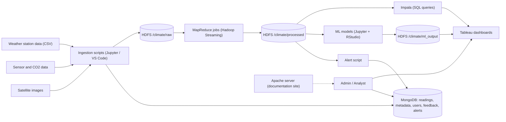

# System Architecture

## Overview diagram


## Layers
| Layer | Components | Purpose |
|---|---|---|
| Ingestion | Python scripts in Jupyter/VS Code | Load historical data; simulate real-time batches |
| Storage | HDFS, MongoDB | HDFS: raw/processed/ML data. MongoDB: readings, metadata, users, feedback, alerts |
| Processing | Hadoop MapReduce (Hadoop Streaming) | Quality check, trends, anomalies, correlation |
| Query | Impala | Fast SQL on processed data |
| Analytics | Jupyter, RStudio | Trend prediction, anomaly detection, correlation |
| Alerts | Alert script, MongoDB `alerts` | Threshold-based notifications |
| Visualization | Tableau | Interactive dashboards |
| Access and docs | MongoDB roles, HDFS permissions, Apache server | Role-based access; hosts user documentation |

## HDFS layout
```
/climate/raw/historical/year=YYYY/
/climate/raw/streaming/
/climate/raw/satellite/
/climate/processed/
/climate/ml_output/
/climate/backup/
```

## Data flow (step by step)
1. Ingestion scripts load historical data into `/climate/raw/historical` and drop small batches into `/climate/raw/streaming` (real-time is simulated).
2. The same readings and the satellite image metadata are stored in MongoDB.
3. MapReduce jobs read both raw folders and write results to `/climate/processed`.
4. Impala external tables are created over the processed folders for analyst queries.
5. ML notebooks read processed data and write predictions to `/climate/ml_output`.
6. The alert script reads anomalies and writes alerts to MongoDB.
7. Tableau reads Impala tables (or CSV exports) and shows dashboards.

## Environment note
The Impala deployment depends on the environment decision (Impala runs on Linux only). This section will be updated once decided.