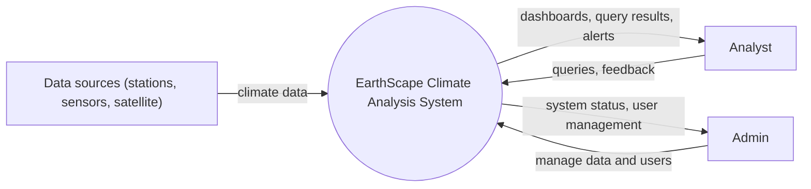
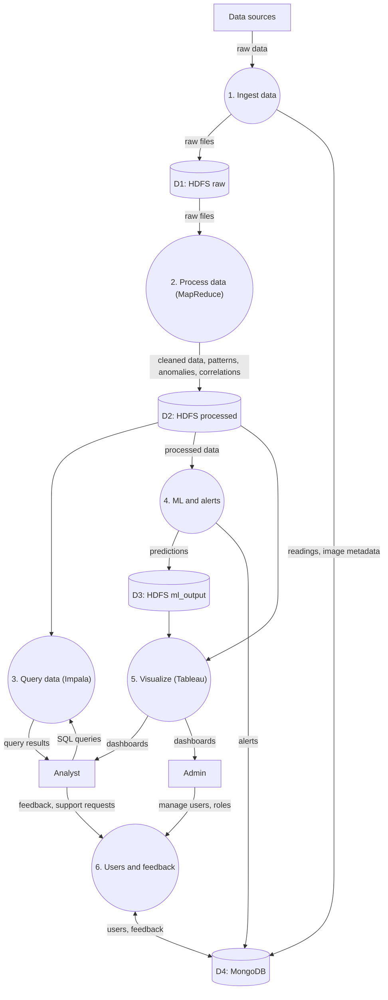

# Data Flow Diagrams

## Level 0 (Context diagram)

## Level 1

## Process descriptions
| No. | Process | Input | Output |
|---|---|---|---|
| 1 | Ingest data | Historical files, simulated real-time batches, satellite images | Files in HDFS raw; records in MongoDB |
| 2 | Process data (MapReduce) | HDFS raw | Cleaned data, yearly averages, anomalies, correlations in HDFS processed |
| 3 | Query data (Impala) | HDFS processed, analyst SQL | Query results |
| 4 | ML and alerts | HDFS processed | Predictions in HDFS ml_output; alerts in MongoDB |
| 5 | Visualize (Tableau) | Processed data, predictions | Interactive dashboards |
| 6 | Users and feedback | Role management, feedback requests | Users, roles and feedback in MongoDB |